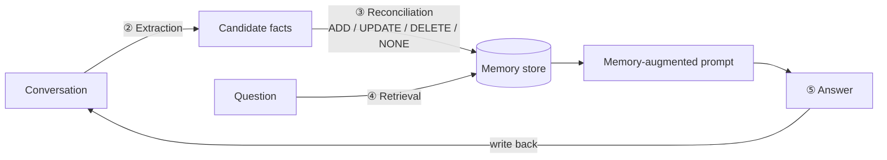

# Long-Term Memory Explorer

An interactive Streamlit app for **seeing** how long-term memory lets an LLM app remember a user
across conversations: which facts get pulled out of a chat, how new facts ADD to, UPDATE or DELETE
old ones, and how the right memories are found again later. It runs a local model through Ollama,
so you can inspect every prompt, score and decision instead of just reading about them.

It's a companion to the *Long-Term Memory* example in
[Generative AI Design Patterns](https://github.com/lakshmanok/generative-ai-design-patterns)
(`examples/28_long_term_memory`), which uses the [mem0](https://github.com/mem0ai/mem0) library.

> **New to this?** Read [docs/how-long-term-memory-works.md](docs/how-long-term-memory-works.md) first.
> It explains every tab in plain language, with diagrams and real outputs from this app.
> Terms are defined in [GLOSSARY.md](GLOSSARY.md).

---

## Quick start

Requirements: [uv](https://docs.astral.sh/uv/) and [Ollama](https://ollama.com/).

```bash
ollama pull qwen2.5:3b           # ~1.9 GB, the default model
uv sync                          # installs Python 3.12 + dependencies into .venv
uv run streamlit run app.py      # opens http://localhost:8501
```

Make sure the Ollama app (or `ollama serve`) is running. The first run downloads the embedding
model `all-MiniLM-L6-v2` (about 90 MB). On an 8 GB Apple-silicon laptop with `qwen2.5:3b`, each LLM
call takes roughly 2 to 15 seconds. Retrieval (tab ④) is instant because it uses no LLM.

Run the tests (no network, no Ollama, no downloads; they use a fake LLM and a fake embedder):

```bash
uv run pytest
```

### Configuration

| Setting | How | Default |
|---|---|---|
| Model | Sidebar dropdown | `qwen2.5:3b` via Ollama. Also offers `qwen2.5:1.5b` (faster, more mistakes), `qwen2.5:7b` (better at reconciliation, but several minutes per step on 8 GB), and `gpt-4o-mini` (the book's choice) |
| OpenAI key (only for gpt-4o-mini) | Sidebar field, or `OPENAI_API_KEY` in the environment, `./.env`, or `../generative-ai-design-patterns/examples/keys.env` | none |
| User id | Sidebar text box | `demo_user` (starts with the demo store); any other id starts empty |
| Ollama address | `OLLAMA_URL=http://host:11434 uv run streamlit run app.py` | `http://localhost:11434` |

Memory stores are saved as JSON in `data/stores/<user_id>.json` (gitignored). They survive app
restarts; that's what makes them *long-term*.

---

## How the app works

Seven tabs, meant to be followed in order. Tabs ② and ③ are the **write path** (what gets saved),
tab ④ is the **read path** (what gets found), and tabs ⑤ and ⑥ put both together.



### ① Why memory?

**Shows:** why an app needs long-term memory, and what it saves compared with pasting everything.

**You provide:** a question (default *What do I do for work?*).

**What happens:** the model answers three times: with no context (22 tokens), with all five past
conversations pasted in (about 1,070 tokens), and with the top 3 memories from the store (about 85
tokens). A chart shows how the "paste everything" prompt grows with history while the memory
prompt stays small.

### ② Extraction

**Shows:** the first write-path step. An LLM reads a conversation and returns the facts about the
user worth keeping, as JSON.

**You provide:** one of the five sample conversations (each with a "what to watch for" note), or
your own.

**What happens:** the conversation is flattened to `user: …` / `assistant: …` lines and sent with
mem0's fact-extraction prompt in JSON mode (`memory_lab/pipeline.py:extract`). You see the
candidate facts, token counts, and the exact prompt and raw reply. **Nothing is saved.**

### ③ Reconciliation

**Shows:** the second write-path step. How new facts change existing memories.

**You provide:** a message, or one of five presets (correct the location trap, move and change
hobbies, repeat something known, share something new, small talk).

**What happens** (`pipeline.reconcile`):

1. Extraction runs on the message.
2. For each candidate fact, the 5 most similar existing memories are found by embedding similarity.
3. Their long ids are swapped for `"0"`, `"1"`, … (mem0's guard against models garbling ids).
4. One LLM call with mem0's reconciliation prompt returns ADD / UPDATE / DELETE / NONE per memory.
5. Decisions are applied and **saved**. Ids the model invented are skipped, not applied.

You see each step's table, the decisions, the store before and after, and a full history log.
An expander lets you **rebuild the demo store** from the five conversations, showing each step.

### ④ Retrieval

**Shows:** the read path. Finding memories by meaning with embeddings and cosine similarity.

**You provide:** a question, `limit` (default 2, as in the book's demo), and an optional minimum score.

**What happens:** the question is embedded with `all-MiniLM-L6-v2` and compared with every
memory's stored embedding. A bar chart ranks every memory, with the retrieved ones in green. A
warning appears when even the best match is weak (try *What's my name?*). A table runs all five
notebook questions at once.

### ⑤ Answering with memory

**Shows:** one full turn of the book's `chat_with_memory` loop.

**What happens** (`pipeline.memory_turn`): retrieve → build the book's memory-augmented system prompt
(shown in full) → answer (temperature 0.7, max 500 tokens, as in the book) → optionally write the
question and answer back through extraction and reconciliation.

### ⑥ Chat

**Shows:** short-term (conversation history) vs long-term (memory store) memory.

**What happens:** each message runs the full loop. The store and its recent changes update live
beside the chat. **Start a new conversation** wipes the chat but keeps the memories. Options: send
chat history or not (the book doesn't), and how many memories to retrieve.

### ⑦ Real mem0

**Shows:** the real `mem0ai==0.1.113` on the same five conversations, with the sidebar's model, the
same embedder, and a fresh temporary Chroma database (`memory_lab/mem0_runner.py`). It compares
mem0's memories and `search()` results with the app's own engine, and points out a gotcha: with
Chroma, mem0's `score` is a **distance** (lower is better). mem0 telemetry is switched off.

---

## Project structure

```
app.py                      Streamlit UI (7 tabs). Only file that knows about Streamlit.
memory_lab/
  pipeline.py               Extraction, reconciliation, retrieval, answering: every step returns its intermediates.
  prompts.py                mem0 0.1.113's prompts, word for word (a test checks), plus the book's answer prompt.
  store.py                  The memory store: JSON file per user, cosine search, history log.
  llm.py                    Ollama and OpenAI chat calls, with token counts and timing.
  embedder.py               all-MiniLM-L6-v2 embeddings (CPU).
  mem0_runner.py            Runs the real mem0 library for tab ⑦.
  demo.py                   Builds the demo store from the five conversations.
  parsing.py, tokens.py     JSON-from-model parsing; token counting.
  data.py                   Loads the sample data.
data/
  sample_conversations.json The book's 5 conversations, word for word, plus a "trap" note each.
  sample_queries.json       The book's 5 test questions.
  demo_store.json           Shipped demo memory store (built with qwen2.5:3b).
  demo_build_log.json       Facts and decisions from building it.
  stores/                   Per-user stores created while you use the app (gitignored).
scripts/build_demo_snapshot.py   Rebuilds data/demo_store.json.
tests/                      Unit tests with a fake LLM and fake embedder.
docs/
  how-long-term-memory-works.md   Beginner's guide.
  adr/                      Architecture decision records.
GLOSSARY.md                 The project's vocabulary.
```

The pipeline never imports Streamlit, Ollama or OpenAI directly. It receives an `LLM` and an
`Embedder`, so the tests can pass in fakes and check the logic exactly (e.g. that short ids map
back to the right memory, and that invented ids are skipped).

---

## Differences from the book's example

See section 13 of the [guide](docs/how-long-term-memory-works.md#13-where-the-app-differs-from-the-books-example).
In short: the app's own engine using mem0's prompts and steps (so every step is visible), a local
model and local embeddings by default, and a JSON file instead of Chroma. Tab ⑦ runs the real mem0
for comparison. See [ADR 0001](docs/adr/0001-own-memory-engine.md).
