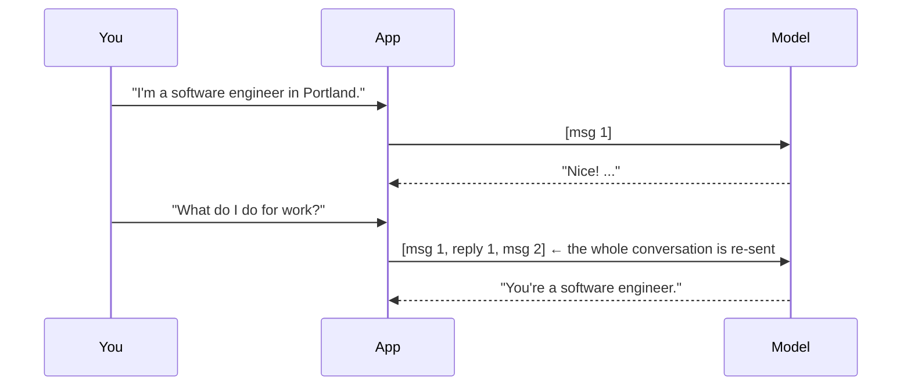
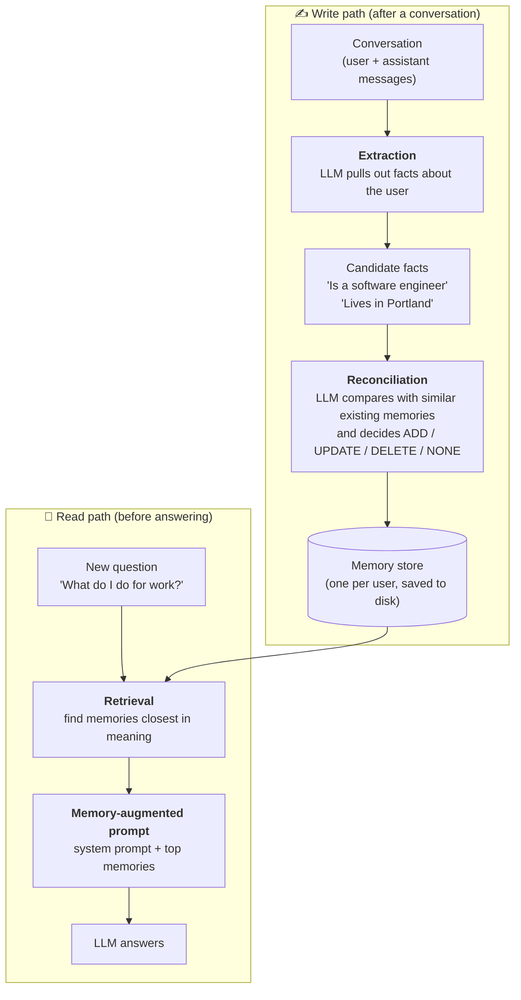
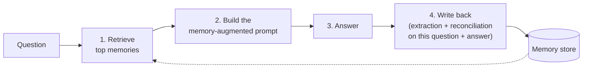

# How Long-Term Memory Works: a Beginner's Guide

This guide explains **long-term memory** for LLM applications from the ground up, and walks through
every tab of the Long-Term Memory Explorer app. You don't need any machine-learning background. If a
word is unfamiliar, look it up in the [glossary](../GLOSSARY.md).

> **The 30-second version.** An LLM remembers nothing between calls. To make an app "remember" a
> user, we do three things outside the model:
> 1. after a conversation, ask an LLM to **pull out the facts worth keeping** ("Is a software
>    engineer", "Favorite author is Isaac Asimov");
> 2. **merge** those facts into a saved list, adding new ones, rewriting changed ones, and deleting
>    ones that are no longer true;
> 3. next time the user asks something, **find the few facts that matter** and paste them into the
>    prompt.
>
> The model never actually learns anything. We just give it a well-chosen cheat sheet each time.

All the examples below are **real outputs** from the app, using the local model `qwen2.5:3b` and
the book's five sample conversations. If you run it yourself your outputs will differ a little,
because LLM output varies from run to run. That variation is part of the lesson.

**Contents**

1. [The problem: LLMs forget everything](#1-the-problem-llms-forget-everything)
2. [The big picture: a write path and a read path](#2-the-big-picture-a-write-path-and-a-read-path)
3. [The sample data and its traps](#3-the-sample-data-and-its-traps)
4. [Tab ①: Why memory?](#4-tab--why-memory)
5. [Tab ②: Extraction](#5-tab--extraction)
6. [Tab ③: Reconciliation](#6-tab--reconciliation)
7. [Tab ④: Retrieval](#7-tab--retrieval)
8. [Tab ⑤: Answering with memory](#8-tab--answering-with-memory)
9. [Tab ⑥: Chat (short-term vs long-term)](#9-tab--chat-short-term-vs-long-term)
10. [Tab ⑦: The real mem0](#10-tab--the-real-mem0)
11. [How this differs from RAG and from a long context window](#11-how-this-differs-from-rag-and-from-a-long-context-window)
12. [Limitations and production concerns](#12-limitations-and-production-concerns)
13. [Where the app differs from the book's example](#13-where-the-app-differs-from-the-books-example)

---

## 1. The problem: LLMs forget everything

When you chat with an LLM, it feels like it remembers what you said earlier. It doesn't. Every call
to the model is completely independent. The model sees **only** the text sent in that one call
(the *prompt*), and when the call ends, nothing is kept.

Chat apps fake memory within a single conversation by re-sending the whole conversation so far
with every new message. That list of messages is the **conversation history**:



This works until one of two things happens:

- **The conversation ends.** Tomorrow you open a new chat, the history starts empty, and the model
  has no idea who you are.
- **The conversation gets too long.** Every model has a maximum prompt size (its *context window*).
  Re-sending everything also costs more money and time with every message.

**Long-term memory** fixes both problems. It keeps a small, separate list of facts about the user
that **outlives any single conversation**, and it sends only the relevant few facts each time.

> **Two kinds of "memory".** This app is strict about the words:
> - **Conversation history**: the messages of the *current* conversation (short-term, thrown away
>   at the end).
> - **Memory store**: the saved facts about a user (long-term, kept forever). Each saved fact is
>   one **memory**.

---

## 2. The big picture: a write path and a read path

A long-term memory system has two halves. The **write path** runs *after* a conversation (or after
each turn) and decides what to save. The **read path** runs *before* answering and decides what to
bring back.



The app follows the open-source library **mem0** (version 0.1.113), which the book's example uses.
It uses mem0's own prompts, copied word for word; a test checks they are identical. Tabs ② and ③
are the write path, tab ④ is the read path, and tabs ⑤ and ⑥ put both together.

Three building blocks show up everywhere:

| Building block | What it is | Where it runs |
|---|---|---|
| **LLM** (here `qwen2.5:3b` via Ollama, or `gpt-4o-mini`) | Reads text, writes text. Used for extraction, reconciliation and answering. | Ollama on your laptop, or OpenAI |
| **Embedding model** (`all-MiniLM-L6-v2`) | Turns a sentence into 384 numbers that capture its meaning. Used to find similar memories. | Your laptop CPU |
| **Memory store** | The list of memories for one user, plus a log of every change. | A JSON file in `data/stores/` |

---

## 3. The sample data and its traps

The book's example comes with **five sample conversations** and **five test questions**. The app
uses them word for word (`data/sample_conversations.json`, `data/sample_queries.json`).

They're deliberately messy. Real users mix useful facts with small talk, trivia and mistakes, and a
memory system has to cope. Each conversation hides a test:

| # | Topic | What's really in it | The trap |
|---|---|---|---|
| 1 | Travel plans | Greetings and weather, then: flying **Seattle → Reykjavik**, needs a hotel and a rental car. | The assistant says "Iceland Air is the only airline". That's a claim by the assistant, not a fact about the user. |
| 2 | Health | "I need to tell you something important about my health"… and then the user **never does**. Just math and planet trivia. | A good extractor saves **nothing**. A careless one might invent a health fact. |
| 3 | Work and location | The user is a **software engineer in Portland, Oregon**, specialising in ML/NLP, 8 years of coding, prefers backend. | The **assistant** wrongly says "San Francisco", and the user then mentions San Francisco's population. Who will the extractor believe? |
| 4 | Hobbies | Loves sci-fi, **Isaac Asimov**, the **Foundation** series, hikes in **Marin County**, learning **guitar**. | Mixed with trivia (Shakespeare, gold's symbol). The assistant again assumes "the San Francisco area". |
| 5 | Space | Not into history, loves **space documentaries**, especially both versions of **Cosmos**. | The moon-landing and leap-year questions are distractors. |

And the five test questions:

1. *What's my name?* (**No name was ever given.** The honest answer is "I don't know.")
2. *What do I do for work?*
3. *What my hobbies are?* (sic, typo from the original)
4. *What are my favorite books?*
5. *What are my travel plans?*

The app comes with a **demo memory store** (`data/demo_store.json`) built by running all five
conversations through the write path with `qwen2.5:3b`. Here's what the model kept, all 13 memories:

```
Asked about airlines flying to Reykjavik
Asked about hotels in Reykjavik
Asked about rental car companies in Reykjavik
Specializes in machine learning and natural language processing
Coding experience of 8 years
Prefers working on backend systems
Favorite author is Isaac Asimov
Favorite Asimov book is the Foundation series
Hiking in Marin County
Learning to play guitar
Asked about the number of days in a leap year
Enjoyed space and astronomy documentaries
Favorite space documentaries are the original Cosmos with Carl Sagan and the newer one with Neil deGrasse Tyson
```

Look closely: there's already a lot to learn here.

- ✅ Conversation 2 (health) produced **nothing**, which is correct.
- ✅ Hobbies, books and documentaries were captured well.
- ❌ **"Software engineer" and "Portland" are missing!** The most important facts in conversation 3
  were dropped.
- ❌ **"Asked about the number of days in a leap year"** is trivia, not a fact about the user.
- ⚠️ The travel facts are phrased as *"Asked about…"* instead of *"Plans to travel to Reykjavik"*.
  That's technically true but less useful.

In another run with the same model (and in the real mem0 run, section 10), the model also saved
**"Lives in San Francisco area"**: it believed the assistant's mistake. Small models are
inconsistent, and a memory system is only as good as the model doing the extraction.

> **Sidebar tip.** The **User id** box picks whose memory store you're looking at. `demo_user`
> starts with the 13 memories above; any other id starts empty. **Reset to demo** puts the
> snapshot back if you've changed things; **Empty store** deletes every memory for that user.

---

## 4. Tab ①: Why memory?

### What you do

Pick a question (default: *What do I do for work?*) and click **Ask three ways**.

### What happens

The app asks the model the same question three times, with three different system prompts:

| Column | System prompt contains | Size |
|---|---|---|
| 🙈 **No memory** | Just "You are a helpful AI assistant." | **22 tokens** |
| 📜 **Paste every past conversation** | All five sample conversations, in full | **1,074 tokens** |
| 🧠 **Long-term memory (top 3)** | The 3 memories most relevant to the question | **84 tokens** |

(A *token* is a chunk of text, about ¾ of a word. Models charge, and slow down, per token.)

### What you see (real output)

**🙈 No memory:**
> *"To provide a precise answer, I would need to know which specific job or career path you are
> referring to. Since you didn't specify, I can offer some general advice…"*

The model has no idea who you are. It can't help.

**📜 Paste everything:**
> *"Based on your previous conversations, it seems like you have a background in software
> engineering and AI. You specialize in machine learning and natural language processing, and you
> work in Portland, Oregon."*

The best answer, because the model sees the raw transcripts, including the Portland fact our
memory store missed. But it cost **13× more tokens** than the memory version.

**🧠 Long-term memory:** retrieved *"Prefers working on backend systems"* (score 0.28), *"Coding
experience of 8 years"* (0.22), *"Specializes in machine learning and natural language
processing"* (0.16), and answered:
> *"For work, you seem to be in a role that involves backend systems, machine learning, and natural
> language processing… with 8 years of coding experience under your belt."*

Good and personal, from a prompt of only 84 tokens. It doesn't say "software engineer" or
"Portland" because extraction never saved them. **Memory can only return what was written in.**

### The chart: what happens as conversations pile up

Below the answers, a chart shows prompt size as the number of past conversations grows. Each
sample conversation is about 200 tokens. Pasting everything grows in a straight line: 1,000
conversations would be around 200,000 tokens, more than gpt-4o-mini's 128k context window, and far
more than the 8k we give local models. The memory prompt stays the same size (3 memories) no matter
how much history there is.

> **Key idea:** pasting everything is accurate but doesn't scale. Memory scales, but it's only as
> good as what extraction saved. The rest of the app is about making that trade-off visible.

---

## 5. Tab ②: Extraction

### The idea

**Extraction** is the first step of the write path. An LLM reads a conversation and returns a short
list of **candidate facts** about the user in JSON, like `{"facts": ["Is a software engineer",
"Lives in Portland"]}`. Small talk, trivia and anything that isn't about the user should be left out.

Why not just save the whole conversation? Because "Hello there! How are you doing today?" is
useless to remember, and a 12-message conversation might contain only 3 facts worth keeping.
Short facts are cheap to store, easy to search, and easy to update later.

### What you do

Pick one of the five conversations (or **Write your own** using `user:` / `assistant:` lines). The
left side shows the conversation and a blue box telling you **what to watch for**. Click
**Extract facts**.

> This tab **doesn't save anything**. It only shows what extraction would produce. Saving
> happens in tab ③.

### What happens, step by step

1. The conversation is flattened into plain text, one line per message, exactly as mem0 does it:
   ```
   Input:
   user: Can you explain what artificial intelligence is?
   assistant: Artificial Intelligence (AI) refers to computer systems that...
   user: That's a good explanation. I work with AI actually - I'm a software engineer in Portland, Oregon.
   ...
   ```
2. It's sent with mem0's **fact-extraction prompt** as the system prompt (about 640 tokens). That
   prompt:
   - tells the model it is a "Personal Information Organizer";
   - lists 7 kinds of information to keep: preferences, personal details, plans, activity
     preferences, health, professional details, miscellaneous favourites;
   - gives six worked examples, including two where the right answer is an empty list (`Hi.` →
     `[]`, `There are branches in trees.` → `[]`);
   - asks for JSON with a `"facts"` key, and nothing else.
3. The model is put in **JSON mode** (it's forced to reply with valid JSON) and replies.
4. The app reads the `"facts"` list. If the reply can't be parsed, mem0 treats it as "no facts",
   and so does the app (you'll see a yellow warning).

Click **See the exact prompt and the model's raw reply** to see every character that was sent and
received.

### What you see (real output, conversation 3)

```json
{"facts": ["Specializes in machine learning and natural language processing",
           "Coding experience for 8 years",
           "Prefers backend development over frontend development"]}
```

Notice:

- It kept the specialisation, the experience and the backend preference.
- It **dropped "software engineer in Portland, Oregon"**, the most important sentence in the
  conversation. This happened in every `qwen2.5:3b` run we tried.
- It correctly ignored the speed-of-light question and San Francisco's population.

Try conversation 2 (health): `qwen2.5:3b` returns `{"facts": []}`, which is correct. Nothing about
the user was actually said.

> **Why this matters:** extraction is a *lossy filter*. Anything it misses is gone for good,
> because the original conversation is thrown away. Anything it gets wrong (like "Lives in San
> Francisco area") will be confidently repeated back to the user later. Better (usually bigger)
> models extract better; the sidebar lets you switch and compare.

---

## 6. Tab ③: Reconciliation

### The idea

Extraction gives us candidate facts, but we can't just append them to the store. Over months a
user says the same things again, changes their mind, moves house, gives up hobbies. If we only ever
add, the store fills with duplicates and contradictions ("Lives in Portland" *and* "Lives in
Seattle").

**Reconciliation** is the step that keeps the store tidy. For each candidate fact, an LLM looks at
the most similar memories already stored and picks one **memory decision**:

| Decision | Meaning | Example |
|---|---|---|
| 🟢 **ADD** | It's new: save it as a new memory. | Store has nothing about a name; new fact "Name is Alex" → ADD |
| 🟡 **UPDATE** | It's about the same thing as an existing memory but adds or changes information: rewrite that memory (it keeps its id). | "Likes to play cricket" + new fact "Loves to play cricket with friends" → UPDATE to the richer version |
| 🔴 **DELETE** | It contradicts an existing memory: remove the old one. | "Loves cheese pizza" + new fact "Dislikes cheese pizza" → DELETE |
| ⚪ **NONE** | It's already known (or irrelevant): change nothing. | "Likes cheese pizza" + new fact "Loves cheese pizza" → NONE (same meaning) |

These examples come straight from mem0's reconciliation prompt, which teaches the model with them.

> **Why is it called "reconciliation" and not "update"?** mem0's code calls this step "update
> memory", but UPDATE is also one of the four decisions. To avoid confusion, this app calls the step
> **reconciliation** and keeps **UPDATE** for the decision.

### What you do

At the top you see the current store. Pick a **preset** (or type your own message), then click
**Extract and reconcile**. The message is treated as a one-message conversation, so it goes through
extraction first, then reconciliation. **Changes are saved** to the current user's store.

| Preset | Message | What a perfect system would do |
|---|---|---|
| Correct the location trap | "Actually, I live in Portland, Oregon, not San Francisco. I work there as a software engineer." | ADD Portland and software engineer; DELETE or UPDATE any San Francisco memory |
| Move and change hobbies | "Big news: I just moved to Seattle. I've given up hiking and I play tennis now." | ADD Seattle and tennis; DELETE "Hiking in Marin County" |
| Repeat something known | "I really like Isaac Asimov's Foundation books." | NONE, because it's already stored |
| Share something new | "My name is Alex, and I'm vegetarian." | ADD both |
| Small talk only | "What's the tallest mountain in the world?" | Nothing at all (no facts, so no reconciliation call) |

### What happens, step by step

The tab shows each of these steps on screen.

**Step A: find similar existing memories.** Every candidate fact is turned into an embedding
(section 7 explains these) and the store is searched for the **5 most similar memories** per fact.
The model only sees these, not the whole store. That keeps the prompt small even when the store has
thousands of memories.

**Step B: give each memory a short id.** Real memory ids are long random strings like
`3f9c2a1e-8b7d-4c…`. Models often copy those wrongly, which would update or delete the wrong
memory. So mem0 swaps them for `"0"`, `"1"`, `"2"`, … before calling the model, and maps them back
afterwards. The app shows this mapping table.

**Step C: the model decides.** One LLM call sends mem0's reconciliation prompt (about 1,500 tokens
of instructions and examples) plus the similar memories and the new facts. The model replies with
JSON listing every memory and an `"event"`: ADD, UPDATE, DELETE or NONE. The app then applies the
decisions to the store:

- **ADD** → a new memory with a new id.
- **UPDATE** → the memory with that short id is rewritten (same real id, new text, new embedding).
- **DELETE** → the memory with that short id is removed.
- **NONE** → nothing.
- If the model uses an id that wasn't in the list it was shown, the decision is **skipped**
  (marked ❌ with a note) instead of crashing or touching the wrong memory.

Finally the tab shows the store **before and after**. A **History log** at the bottom records
every change ever made: when, what it was before and after, and what caused it (e.g. "Conversation
3", "Tab ③", "Chat").

### What you see (real output with `qwen2.5:3b`)

**Correct the location trap:**

- Extracted: `Lives in Portland, Oregon`, `Works as a Software engineer`
- Similar memories found for "Works as a Software engineer": *Prefers working on backend systems*
  (0.44), *Specializes in machine learning…* (0.44), *Coding experience of 8 years* (0.42)
- Decisions: 🟢 ADD *Lives in Portland, Oregon*, 🟢 ADD *Works as a Software engineer*

That's correct: it repairs what extraction missed earlier. (This demo store has no San Francisco
memory to delete. If yours does, watch whether the model DELETEs it.)

**Move and change hobbies:**

- Extracted: `Moved to Seattle`, `Given up hiking`, `Play tennis now`
- Similar memory found for "Given up hiking": *Hiking in Marin County* (**0.50**)
- Decisions: 🟢 ADD, 🟢 ADD, 🟢 ADD

❌ The model **didn't delete "Hiking in Marin County"**, even though it was shown that memory right
next to "Given up hiking". The store now says both "Hiking in Marin County" and "Given up hiking".
A contradiction has crept in.

**Repeat something known:**

- Extracted: `Favourite author is Isaac Asimov`, `Favourite book series is Foundation`
- Similar memories: *Favorite author is Isaac Asimov* (**0.98**, almost identical!), *Favorite
  Asimov book is the Foundation series* (0.78)
- Decisions: 🟢 ADD, 🟢 ADD

❌ The store now holds **"Favorite author is Isaac Asimov" and "Favourite author is Isaac
Asimov"**: a duplicate differing only by British spelling.

**Small talk only:** extraction returns no facts, so reconciliation is **skipped entirely**: no
LLM call, no cost. That's a deliberate mem0 optimisation.

> **What we learned:** with `qwen2.5:3b`, reconciliation basically always says ADD. The
> mechanism is right (the model *was shown* the conflicting memory) but the model isn't good enough
> to act on it. This is the hardest step for a small model: it has to follow a long prompt, compare
> meanings, and produce structured JSON, all at once. In practice you'd use a stronger model for the
> write path. That's a good use of money, because it runs once per conversation, not once per
> question. Try the presets again with a bigger model from the sidebar. `qwen2.5:7b` is the next
> step up but very slow on an 8 GB laptop; `gpt-4o-mini` (the book's choice) needs an OpenAI key.

**The same presets with `qwen2.5:7b`** (more than twice the size; real output, but it took about
**8½ minutes** and **4 minutes** on an 8 GB MacBook):

- *Move and change hobbies*: 🟢 ADD *Moved to Seattle*, and 🟡 **UPDATE** *Hiking in Marin County* →
  *Now play tennis*. The bigger model noticed the conflict and replaced the old hobby. ✅
- *Repeat something known*: it pointed at the existing memory *Favorite Asimov book is the
  Foundation series* with an UPDATE that didn't change the text (the app marks this ❌ *skipped:
  text unchanged*), but then **also** added *Favourite books are Isaac Asimov's Foundation books*.
  Better, still not perfect.

Bigger models are better at reconciliation, and a lot slower on a laptop.

---

## 7. Tab ④: Retrieval

### The idea

**Retrieval** is the read path. The user asks a question; we need to find the few memories that
are relevant to it. A store might hold thousands of memories, so we can't send them all.

Searching by keywords wouldn't work well. *"What do I do for work?"* shares no important words with
*"Specializes in machine learning and natural language processing"*. We need to search by
**meaning**.

### Embeddings: meaning as numbers

An **embedding model** turns any sentence into a list of numbers, here 384 of them. For example,
*"Favorite author is Isaac Asimov"* becomes `[-0.047, -0.033, 0.008, 0.056, 0.010, …]` (384
numbers). The individual numbers mean nothing on their own. What matters is that **sentences with
similar meanings get similar lists of numbers**.

To compare two sentences we compare their lists with **cosine similarity**. Think of each list as an
arrow pointing in some direction in a 384-dimensional space. Cosine similarity measures how much
two arrows point the same way:

- **1.0** → same direction → same meaning
- **around 0** → unrelated
- **negative** → pointing apart (rare for sentences)

Real numbers from the app's embedding model:

| Sentence A | Sentence B | Similarity |
|---|---|---|
| Favorite author is Isaac Asimov | Favourite author is Isaac Asimov | **0.98** (same meaning, one letter different) |
| Favorite author is Isaac Asimov | Who is my favorite author? | **0.78** (a question and its answer) |
| Learning to play guitar | Who is my favorite author? | **0.07** (unrelated) |
| Favorite author is Isaac Asimov | Learning to play guitar | **0.00** (unrelated) |

This number is the **similarity score** you'll see everywhere in the app. Every memory's embedding
is computed once, when it's saved, and stored next to its text in the JSON file. At question time
only the question needs embedding, which is fast. Retrieval uses **no LLM at all**, which is why
this tab responds instantly.

### What you do

Pick a question, or write your own. Two controls:

- **limit**: how many memories to retrieve (mem0's `limit`). The book's demo uses 2; its chat loop
  uses 3.
- **Minimum score** (optional): only keep memories scoring at least this much (mem0's
  `threshold`).

### What you see

A bar chart of **every** memory in the store, ranked by similarity to the question. The retrieved
ones are green, the rest grey. Below it, a table runs all five notebook questions at once.

**A question with good matches, *What are my favorite books?*** (real scores):

```
0.581  Favorite Asimov book is the Foundation series     ← retrieved
0.581  Favorite author is Isaac Asimov                   ← retrieved
0.332  Enjoyed space and astronomy documentaries
0.285  Favorite space documentaries are the original Cosmos ...
0.169  Learning to play guitar
...
```

Two clear winners, well ahead of the rest.

**A question with no good match, *What's my name?*** (real scores):

```
0.198  Favorite author is Isaac Asimov                   ← retrieved anyway!
0.123  Enjoyed space and astronomy documentaries         ← retrieved anyway!
0.113  Favorite Asimov book is the Foundation series
...
```

No name was ever given, so nothing is relevant. The top score is under 0.2. But retrieval **always
returns the top `limit` results**, however poor, unless you set a minimum score. The app shows a
warning when the best score is below 0.3. Tick **Minimum score** with 0.3 and the list becomes
empty, which is the honest answer.

> **Why this matters:** irrelevant memories in the prompt aren't free. They cost tokens, and they can
> tempt the model into "personalising" an answer with unrelated facts ("Your name? Well, you love
> Isaac Asimov…"). A threshold helps, but the right value depends on the embedding model. 0.3
> works for MiniLM here; other models need different values.

**Notice also:** *What my hobbies are?* retrieves *"Enjoyed space and astronomy documentaries"*
(0.23) and *"Coding experience of 8 years"* (0.22), but misses *"Hiking in Marin County"* and
*"Learning to play guitar"*. The word "hobby" never appears in those memories, and the small
embedding model doesn't connect "hiking" with "hobby" strongly. Retrieval by meaning is powerful,
not perfect.

---

## 8. Tab ⑤: Answering with memory

### The idea

This tab runs **one complete turn** of the book's chat loop, `chat_with_memory`, and shows every
step:



### What you do

Pick a question (default: *What are my favorite books?*), set the limit (default 3, like the book's
chat loop), choose whether to **write the turn back**, and click **Run one turn**.

### What happens and what you see (real output)

**Step 1, Retrieve:** *Favorite Asimov book is the Foundation series*, *Favorite author is Isaac
Asimov*, *Enjoyed space and astronomy documentaries*.

**Step 2, Build the memory-augmented prompt.** This is the exact system prompt from the book's
example; the app shows it in full:

```
You are a helpful AI assistant. You have access to the following memories from previous conversations:

- Favorite Asimov book is the Foundation series
- Favorite author is Isaac Asimov
- Enjoyed space and astronomy documentaries

Use this context to provide personalized and relevant responses. If the memories contain relevant
information, incorporate it naturally into your response.
```

That's the whole trick of long-term memory: **memories are just text pasted into the prompt.**
The model isn't changed in any way.

**Step 3, Answer:**
> *"Based on the information you provided, it sounds like your favorite author is Isaac Asimov, and
> you particularly enjoy his works in the Foundation series…"*

**Step 4, Write back.** The question and the answer are run through extraction and
reconciliation, exactly like a conversation in tab ③. Here the model extracted *"Favorite author is
Isaac Asimov"* and *"Enjoys the Foundation series by Isaac Asimov"*, and reconciliation said
**ADD** to both, creating near-duplicates again.

> **A subtle risk in write-back:** the conversation sent to extraction includes the *assistant's*
> answer. If the assistant says something wrong ("You live in San Francisco"), extraction may save
> it as a fact about the user. This is exactly conversation 3's trap, and it can make mistakes
> reinforce themselves over time. Untick **Write the turn back** to answer without changing the
> store.

---

## 9. Tab ⑥: Chat (short-term vs long-term)

### What you do

Chat freely in the box at the bottom. Each message runs the full loop from tab ⑤. On the right
you see the **memory store** and its **recent changes** update live. Under each reply, expand
**What memory did this turn use and change?** to see what was retrieved, which facts were
extracted, and the decisions.

### The experiment to try

1. Say something new about yourself: *"I just adopted a cat named Miso."* Watch a new memory
   appear on the right.
2. Click **🆕 Start a new conversation (memories stay)**. The chat on the left is wiped: that's
   the **conversation history** (short-term) being thrown away, like closing a chat window.
3. Ask *"What's my pet's name?"* The model has no conversation history now. If extraction saved
   the cat (check the store on the right), retrieval finds it in the **memory store** (long-term)
   and the model can still answer. If extraction missed it, the model can't, which is the same
   lesson from the other side.
4. Stop the app completely and start it again. The memory is still there, because it lives in
   `data/stores/demo_user.json`, not in the app's memory. That's what makes it *long-term*.

### Options

- **Send chat history**: include earlier messages of this chat in the prompt (on by default, like
  a normal chat app). The book's example doesn't do this; each turn sees only memories. Turn it off
  to see the example's exact behaviour, where the model can't even remember your previous message
  unless it was saved as a memory.
- **limit**: how many memories to retrieve per turn.
- **User id** (sidebar): switch to another id, such as `alice`, and you get an empty store. Memories
  are kept **separate per user**, which is what the book's `user_id=` argument does. Switch back to
  `demo_user` and everything is still there.

---

## 10. Tab ⑦: The real mem0

### Why this tab exists

Tabs ① to ⑥ run the app's own small engine so that every step is visible. This tab checks that the
engine is faithful by running the **real `mem0ai` library, version 0.1.113** (the exact version
the book pins) on the same five conversations, then running the five questions through
`memory.search()`.

It uses the model chosen in the sidebar, the same embedding model, and a **fresh temporary Chroma
database** each run, just like the book's `get_memory_config()`. mem0's usage telemetry is switched
off.

### What happens

1. `memory.add(conversation, user_id="demo_user")` for each of the 5 conversations (2 LLM calls
   each: extraction and reconciliation).
2. `memory.get_all()` to list the final memories.
3. `memory.search(question, limit=2)` for each of the 5 questions.

With `qwen2.5:3b` this took **93 seconds**.

### What you see (real output)

**What `memory.add()` returned:** conversation 1 → 3 ADDs (the Reykjavik "Asked about…" facts),
conversation 2 → nothing, conversation 3 → 3 ADDs (ML/NLP, 8 years, backend), conversation 4 → 5
ADDs, **including "Lives in San Francisco area"**, conversation 5 → 3 ADDs (including the leap-year
trivia). 14 memories in total.

**mem0's memories vs the app's engine:** in our first test run, the app's engine produced the **same
14 facts, word for word**, as mem0. That's expected, since it uses the same prompts, the same
model and the same steps. The shipped snapshot (13 memories) is from a later run in which the model
happened not to save "Lives in San Francisco area". Same input, same model, different output: LLMs
vary from run to run, so compare the *kind* of thing kept and dropped, not the exact wording.

**`memory.search()` results:**

| Query | Memory | mem0 "score" | As cosine similarity |
|---|---|---|---|
| What are my favorite books? | Favorite Asimov book is the Foundation series | 0.838 | 0.581 |
| What are my favorite books? | Favorite author is Isaac Asimov | 0.839 | 0.581 |
| What's my name? | Lives in San Francisco area | 1.442 | 0.279 |
| What are my travel plans? | Asked about hotels in Reykjavik | 1.417 | 0.291 |

The cosine column matches the similarity scores in tab ④ exactly (0.581, 0.291…). Same embeddings,
same ranking.

### ⚠️ The gotcha: mem0's "score" is a distance

Look at the "score" column: **lower means more relevant**. With Chroma as the database, the number
mem0 returns as `score` is a **distance** (how far apart the two arrows are), not a similarity.
The best match for "favorite books" has score 0.838, and the poor match for "What's my name?" has
1.442.

Because MiniLM's embeddings all have length 1, the two are directly related:
**cosine similarity = 1 − distance ÷ 2**. The app shows both columns.

This matters if you use mem0's `threshold` option. In version 0.1.113, mem0 keeps results where
`score >= threshold`. With a distance, that keeps the **worst** matches and throws away the best.
It's an easy mistake to make, and you'd only find it by looking at the numbers, which is the point
of this app.

---

## 11. How this differs from RAG and from a long context window

Long-term memory looks a lot like **RAG** (retrieval-augmented generation: search documents, paste
the relevant parts into the prompt). The read path is the same idea. The differences are in what's
stored and how it gets there:

| | RAG | Long-term memory | Long context window |
|---|---|---|---|
| **What's stored** | Chunks of documents (manuals, wikis) | Short facts about one user | Nothing: everything is re-sent |
| **Who writes it** | You, ahead of time | The LLM, automatically, after each conversation | n/a |
| **Changes over time?** | Rarely; you re-index documents | Constantly: ADD / UPDATE / DELETE | n/a |
| **Scope** | Usually shared by all users | One store per user | One conversation |
| **Main risk** | Retrieving the wrong chunk | Saving a wrong fact, or missing a right one | Cost, speed, and models getting worse at using information buried in the middle of very long prompts |

The write path (extraction and reconciliation) is what makes long-term memory a separate pattern:
the system **curates its own knowledge** about each user as it goes.

---

## 12. Limitations and production concerns

What you saw in this app shows up in real systems too.

**Wrong facts get saved.** The model can believe the assistant over the user ("Lives in San
Francisco area"), save trivia as facts ("Asked about the number of days in a leap year"), or phrase
facts vaguely ("Asked about hotels in Reykjavik"). Once saved, a wrong memory is confidently
repeated in every future answer. Mitigations: use a strong model for extraction, extract only from
the user's messages, let users see and edit their memories (like ChatGPT's "Manage memories"
screen).

**Right facts get missed.** "Software engineer in Portland" never made it into the store. The
original conversation is gone, so the fact is lost for good. Some systems keep the raw
conversations too, as a backup to re-extract from later.

**Contradictions and duplicates pile up** when reconciliation is weak (tab ③: "Hiking in Marin
County" alongside "Given up hiking"; "Favorite" and "Favourite" author). Over time the store gets
noisy and retrieval gets worse. Stronger models help; some systems also run a periodic clean-up job.

**Stale memories.** "Plans to travel to Reykjavik" is true in March and stale by September. Plain
facts have no expiry date. Production systems add timestamps (this app's store records `created_at`
and `updated_at`) and can prefer recent memories or let old ones expire.

**Privacy.** A memory store is a profile of a person. It may contain health information (the
extraction prompt explicitly asks for it), location and relationships. You need consent, a way for
users to see what's stored, and a way to **delete all of a user's data**: in this app, **Empty
store**; in mem0, `memory.delete_all(user_id=...)`. Keep stores separated per user (the `user_id`)
so one user's memories never leak into another's answers.

**Cost and speed.** Every conversation turn costs **two extra LLM calls** on the write path
(extraction about 900 tokens in, reconciliation about 1,500 to 1,700 tokens in, mostly instructions).
That's more than the answer itself. Ways to reduce it: write back once per conversation instead of
once per turn, run the write path in the background so the user doesn't wait, and skip
reconciliation when extraction finds nothing (mem0 already does this).

**Irrelevant retrieval.** Retrieval always returns *something* unless you set a threshold (tab ④:
"What's my name?"). Choose the threshold for your embedding model, and remember mem0's Chroma
scores are distances (section 10).

---

## 13. Where the app differs from the book's example

| Book example (`basic_memory.py`) | This app | Why |
|---|---|---|
| Calls `mem0.Memory` directly | Own engine following mem0's algorithm and prompts (tabs ①–⑥); real mem0 in tab ⑦ | To show every intermediate step. See [ADR 0001](adr/0001-own-memory-engine.md). |
| `gpt-4o-mini` + OpenAI embeddings | `qwen2.5:3b` via Ollama by default (gpt-4o-mini optional) + local MiniLM embeddings | Free, runs offline, no key needed. |
| Chroma vector database in a temp folder | A JSON file per user in `data/stores/` with cosine search | You can open the file and see exactly what's remembered; it survives restarts. |
| Each chat turn sees memories only | Chat tab can also send the conversation history (toggle) | To contrast short-term and long-term memory. |
| mem0 applies an UPDATE even when the text is unchanged | Skips it, marked *text unchanged* | Same end result, but the history log only records real changes. |
| Prints results to the terminal | Shows prompts, raw replies, scores, decisions, and a history log | The point of the app. |

Everything else (the extraction prompt, the reconciliation prompt and its short-id trick, 5
similar memories per fact, the answer prompt, temperature 0.1 for memory calls and 0.7 for answers,
limit 2 for the demo and 3 for chat) matches the book's example and mem0 0.1.113.
